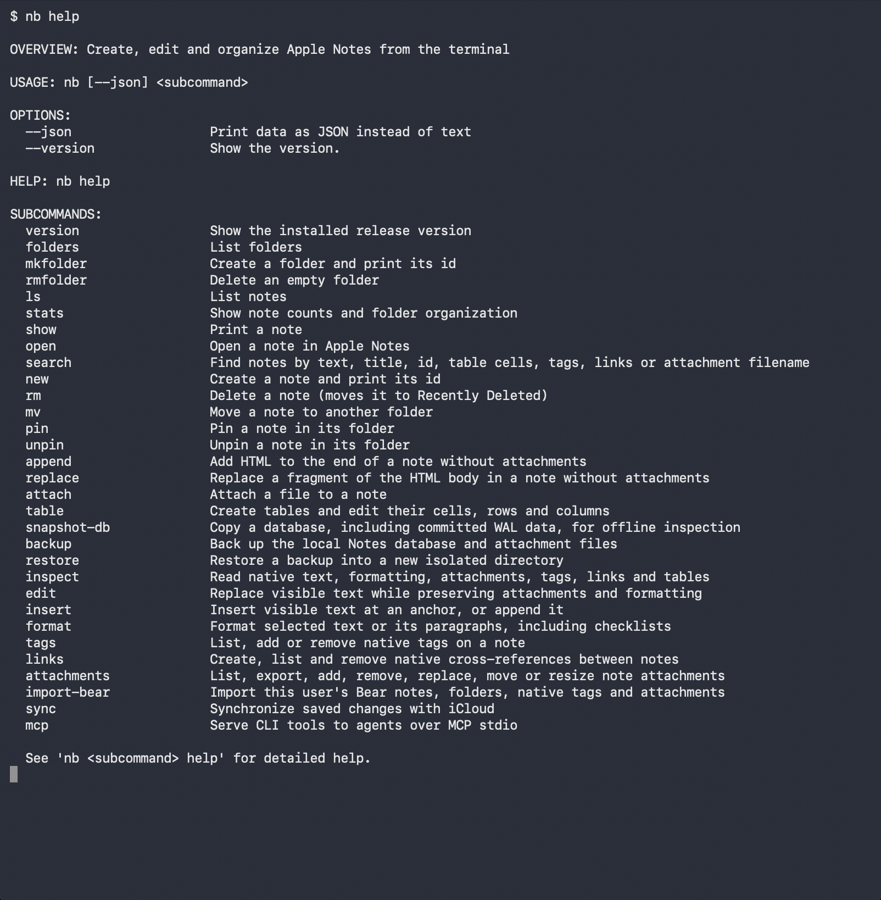
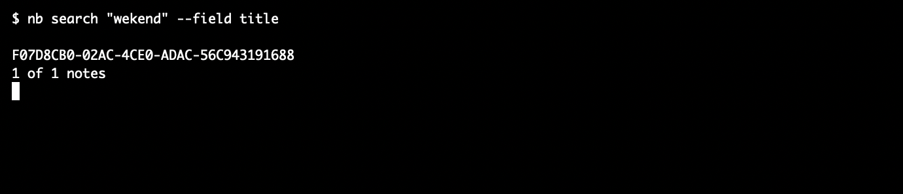
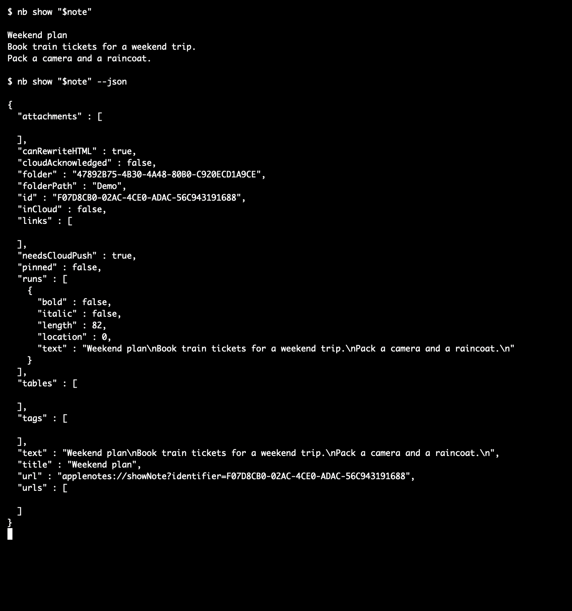
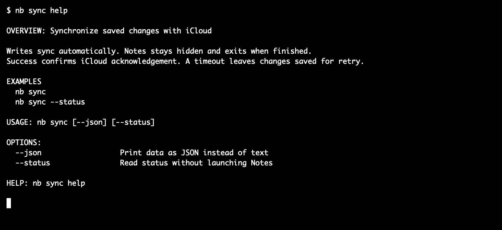
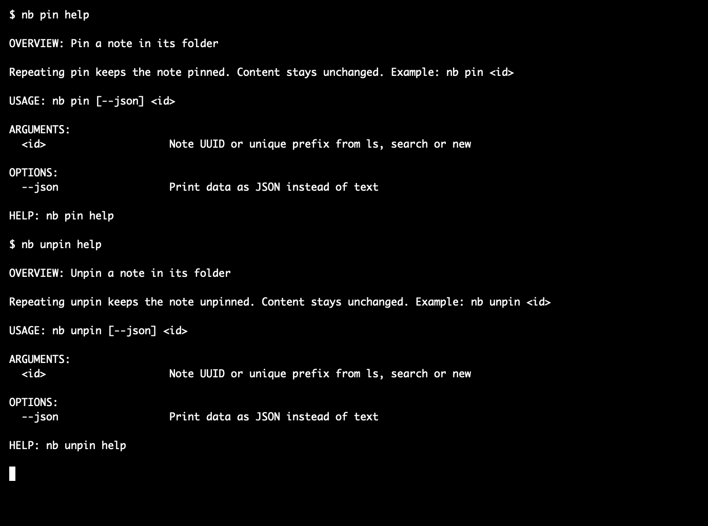
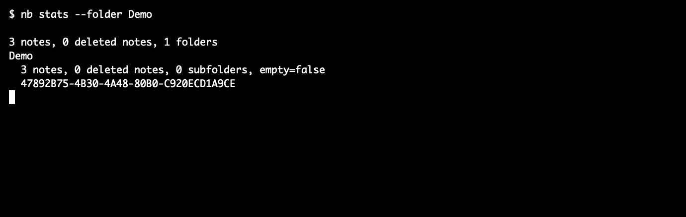

# notes-buddy

Read, search, edit and organize Apple Notes from the terminal.
The executable is named `nb`.
Uses this Mac's existing Notes account. No separate login or AppleScript.

Writes sync automatically with iCloud. Notes runs hidden during synchronization and exits afterward.

## Install

Requires macOS, Apple Notes, Homebrew and Apple's Command Line Tools.
Install from our own tap, not Homebrew Core:

```sh
brew tap noma4i/notes-buddy https://github.com/noma4i/notes-buddy.git
brew install noma4i/notes-buddy/nb
```

Homebrew builds the CLI on your Mac. Update it with:

```sh
brew update
brew upgrade noma4i/notes-buddy/nb
```

While the repository is private, your Git credentials need repository access.
With GitHub CLI, configure them using `gh auth login` and `gh auth setup-git`.
GitHub installation becomes available after the tap changes are pushed and their workflow finishes.

## Start here

```sh
nb help
nb version
nb search "invoice"
```

Search prints 1 note UUID per line. For example:

```text
4B34F396-8895-4AC0-B593-28A8C5DD3521
```

Copy an ID from your results, or use its unique prefix of at least 8 characters:

```sh
nb show 4B34F396
nb show 4B34F396 --json
nb open 4B34F396
```

This example ID is fictional. Your ID will differ.
IDs do not contain local database addresses or row numbers. System folder UUIDs derive from their account and system name.
Ambiguous prefixes fail. Add more characters instead of guessing.
`show` includes tables, tags, links and attachment access. JSON also includes formatting and native object details.
`show --html` prints only HTML. `show --html --json` includes HTML and the same object metadata.
`open` shows the selected note in Apple Notes and leaves the app running. JSON readers also return its `applenotes://` URL.

## Connect an AI agent

Start the built-in MCP server with `nb mcp`. Add this entry to your agent's MCP config:

```json
{
  "mcpServers": {
    "notes-buddy": {
      "command": "/absolute/path/to/nb",
      "args": ["mcp"]
    }
  }
}
```

Use `command -v nb` to find the executable path. The agent starts and stops the server.
Tools cover the CLI commands, including search, folders, pin, attachments, backup and restore.
Each tool describes its parameters. Names use underscores, for example `attachments_export` and `table_set`.
Call `help` with a tool name for full command help. Results contain structured JSON and the same data as the CLI.
Set `html` or `csv` to `-` and pass text in `stdin` to avoid creating input files.
Requests run one at a time. Writes use automatic synchronization. Only `open` displays Notes.
Stdio needs no port, token, Node.js or separate server executable.

## Try editing

To try editing, create a disposable note in a new folder.
The variable `note` saves the UUID returned by `new`. `"$note"` reads that saved ID in later commands.

```sh
nb mkfolder "CLI Demo"
note=$(nb new --folder "CLI Demo" --title "Project plan")
nb insert "$note" --text "Draft budget"
nb edit "$note" --find "Draft" --with "Final"
nb show "$note"
```

Check each exit code before continuing. A failed sync can leave a successful local write.
Inspect saved state and retry `sync`, not `new`.

## Commands

Put `help` immediately after any command or action. Everything after it is ignored. Help never opens the database.

```sh
nb search help
nb table set help
nb attachments export help
```

| Task | Commands |
| --- | --- |
| Check installed version | `version`, `--version` |
| Read notes | `ls`, `show`, `inspect` |
| Open in Notes | `open` |
| Find notes | `search` |
| Create, move, delete | `new`, `mv`, `rm` |
| Pin or unpin | `pin`, `unpin` |
| Manage folders | `folders`, `mkfolder`, `rmfolder` |
| Count notes and folders | `stats` |
| Edit visible text | `edit`, `insert` |
| Edit HTML without native objects | `append`, `replace` |
| Apply styles or checklists | `format` |
| Edit tables | `table` with `ls`, `new`, `set`, `add-row`, `rm-row`, `add-col`, `rm-col` |
| Manage files | `attachments` with `ls`, `add`, `export`, `replace`, `mv`, `rm`, `view`. `attach` also adds files |
| Manage native tags | `tags` |
| Link notes | `links` with `ls`, `add`, `rm` |
| Import Bear | `import-bear` |
| Copy database records | `snapshot-db` |
| Back up local data | `backup`, `restore` |
| Sync or check status | `sync`, `sync --status` |
| Connect agents | `mcp` |

Folder selectors accept a name or ID. Use IDs for ambiguous names.
Actions reject options that they do not use. For example, `attachments ls` does not accept `--file`.
Moves preserve note IDs and contents. `rm` moves notes to Recently Deleted.
`rmfolder` accepts only empty folders without subfolders.

Pin a note with `nb pin "$note"`. Remove its pin with `nb unpin "$note"`.
Repeated commands keep the requested state. Both sync automatically and preserve note contents.
Use `nb inspect "$note" --json` to read the `pinned` field.

## Folder statistics

```sh
nb stats
nb stats --folder Work --json
nb folders --json
```

Folder data includes its UUID, path, active notes, deleted notes, direct subfolders and `empty`.
`stats --folder` includes descendants. Its totals sum those folders without counting a note twice.
A folder is empty only when it has no notes, deleted notes or subfolders.

## Search

Partial words, phrases, fuzzy matching, PDF text and image OCR work by default.
Search ignores case, accents and whitespace differences. Exact matches rank before fuzzy matches.
Numbers, IDs and punctuation stay literal. Deleted notes are excluded.

```sh
nb search "wekend" --field title
nb search "Invoice number" --field document
nb search "report.pdf" --field attachment
nb search "budget" --folder Work --limit 20 --offset 20
nb ls --tag invoices
```

`--field` accepts `all` (default), `id`, `title`, `text`, `tag`, `link`, `attachment` or `document`.
Text search includes table cells. Attachment search finds filenames. Document search reads PDFs and images locally.
Up to 4 files are indexed in parallel. Later searches reuse extracted text until a file changes.
The private index lives in `~/Library/Caches/notes-buddy/documents-v1`. Search never launches Notes or changes its database.
JSON includes `scannedDocuments`, `cachedDocuments` and document errors. Images of 2 pixels or less have no searchable text.
Missing files and extraction errors are reported. OCR does not modify Notes.
Malformed PDFs can produce a macOS decoding warning during first indexing.
JSON search and lists include attachment metadata. `folder` always contains a folder UUID, while `folderPath` contains its readable path.

## Files, tags and links

```sh
nb attachments add "$note" --file report.pdf
nb attachments ls "$note" --json
nb attachments export "$note" --directory ./saved-files
nb tags "$note" --add 'invoices/tech,review'
```

Export saves local files without changing the note. It checks the whole batch and never overwrites existing files.
Duplicate names get numeric suffixes. Tables are skipped. Disk errors can leave completed copies.
Missing iCloud files are not downloaded. Add `--attachment` to directory export to select 1 file.

Tags are native objects. Slashes, commas and whitespace split names into separate tags, not nested tags.
Links are one-way. Add a reverse link for a bidirectional relationship.
Use `links add` with your source note ID and `--to` followed by the target note ID.
For exporting 1 file, get its UUID from `show --json` or `attachments ls`, then read `attachments export help`.
Attachment metadata includes `id`, owning `note`, `type`, `name`, `available` and `exportable`.
Locally stored files also include `path` and a `file://` URL. Native tables have no exportable file and appear in `tables`.
Web links appear in `urls`, with their label and address. Links between notes appear in `links`.
A link to a PDF website is not a file attachment. Export does not download web links.

Use `edit`, `insert`, `format` and native table commands to preserve attachments and links.
Text edits use literal matches. Missing or ambiguous selections fail. Table indices start at 1.
HTML rewrites refuse objects or checklists they could lose.

## Bear import

Requires `pandoc`, defaulting to `/opt/homebrew/bin/pandoc`. Override with `--pandoc`.

```sh
nb import-bear --dry-run
nb import-bear --limit 3
nb import-bear
```

Import reads Bear without modifying it. Tag paths create folders. Files, native tags and cross-references are preserved.
Repeated imports skip existing notes without overwriting them. `--repair-folders` restores their expected folder paths.
Earlier notes can remain saved if a later import fails. Keep stderr and the JSON mapping when importing.

## Output and safety

Every command accepts `--json` for data. Help and errors always remain text.
`nb version` and `nb --version` print the release version. `nb version --json` returns its name and version.
Invalid commands return a nonzero exit code and a help hint. Synchronization failures do not hide saved local changes.

| Default stdout | Commands |
| --- | --- |
| Note UUIDs, 1 per line | `search`, `ls`, note writes, import |
| Folder UUIDs, paths and counts | `folders`, `stats` |
| Affected folder UUID | Folder writes |
| Saved paths | Attachment export, snapshots |
| Requested text or fields | Readers and status commands |

No matches produce empty search stdout. Text search reports returned and total matches in stderr, including zero results.
Text lists report their note count in stderr. Saved actions report their action and destination there.
JSON actions include `action`, `saved` and the affected object's data. Folder creation includes its initial counts.
`saved` means saved locally. Exit code 0 confirms synchronization. Use `inspect` or `sync --status` for current cloud status.
Progress and errors use stderr. JSON import returns `notes` and `summary`.

Before writes, the CLI closes Notes normally. Do not open Notes or run another writer during a write.
If database access is denied, check the calling application's Full Disk Access.
Saved writes wait up to 120 seconds for iCloud acknowledgement, then recheck the queue after Notes exits.
There is no sync bypass flag. Readers and `sync --status` do not launch or close Notes. `open` explicitly launches Notes.
Acknowledgement is not proof that another device has displayed the change.

Snapshots include database records and committed WAL data, but not attachment files.
They are not complete backups. Never restore a snapshot over a live iCloud database.

## Backup and isolated restore

```sh
nb backup ./notes-backup --json
nb restore ./notes-backup --to ./restored-notes --json
```

Backup copies the local database and files, including committed WAL data. It verifies file checksums and database integrity.
Both destinations must be new directories. Their parent directories must already exist.
Missing required attachments, source changes or invalid files cause an error instead of a partial backup.
Restore verifies the archive before copying it. It never replaces your working database or changes iCloud.
Restored files stay in the chosen directory. They are not imported into Notes.
These commands do not launch or close Notes. Keychain credentials are not backed up. Locked data remains encrypted.

Unsupported: folder rename or move, cross-account moves, restore into a Notes account, permanent deletion, passwords, sharing and smart-folder administration.
Protected, shared and deleted notes have write restrictions. There is no multi-command transaction or undo.



<details>
<summary>More examples</summary>






</details>

## License

No project license has been selected. Do not assume an open-source license.
